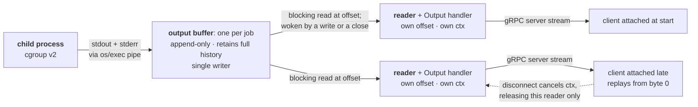

# bantay

*bantay*, Tagalog for guard, runs, isolates, and watches processes on behalf of
authenticated clients.

## Overview

A service that runs arbitrary Linux processes on behalf of authenticated
clients and streams their output. Clients start, stop, and query jobs over gRPC
secured with mTLS authentication. Each job runs under its own cgroup v2
resource limit, and its output is streamed to any number of
concurrent clients from the moment the process started.

The central design problem is output delivery. A client may attach before a
job has produced anything, midway through, or after it has exited, and every
client must receive the same complete byte stream from the beginning.
Isolation is provided by kernel facilities while output delivery has to be
designed. This is why it accounts for most of the decisions below.


## Scope

### In scope

- Start a process from an explicit argv, with no shell interpretation.
- Stop a job, terminating the process and every descendant it spawned.
- Query a job's state and exit code.
- Stream a job's output to any number of concurrent clients, each receiving the
  complete byte stream from the process's first write.
- gRPC transport secured with mTLS; caller identity is a SPIFFE ID carried in
  the client certificate.
- Output delivery that blocks on state change rather than polling.
- Per-job CPU, memory, and block I/O limits via cgroup v2.
- Administrative identities that may act on any job.

### Out of scope

Deliberately not implemented: listing jobs, persistence across a restart, job
eviction, client-supplied start offsets, separate stdout and stderr,
configurable limits, rate limiting and job quotas, audit logging, and network
isolation. A job has unrestricted network access.

**Job eviction.** A job's output buffer is retained after its process exits so
that clients attaching late still receive the complete stream. What is missing
is an upper bound on that retention: nothing reclaims a completed job's buffer,
so memory grows with the number of jobs run and is released only when the server
exits. Output is retained in full, so a single verbose job can exhaust the
server's memory on its own, and the absence of rate limiting means a client can
start as many such jobs as it likes. Production would need a retention policy
and a bound on output size.

**Listing jobs.** `Start` returns the job ID and the client retains it. The
registry is in memory and does not survive a restart, so an ID is only
meaningful for the lifetime of the server process, and the client that created
it holds it already. A second client belonging to the same identity must be
given the ID out of band.

**Client-supplied start offsets.** Every `Output` call is independent and begins
at byte 0, so a client that drops and calls again replays from the start. The
buffer retains full history and reads accept an arbitrary offset, so supporting
this would be a small change.

### Environment assumptions

- Linux with the cgroup v2 unified hierarchy mounted at `/sys/fs/cgroup`.
- Kernel 5.7 or later for `CLONE_INTO_CGROUP`; Version 5.14 or later for `cgroup.kill`.
- **A provisioned subtree.** A cgroup v2 subtree delegated to the server's
  user, with `cpu`, `memory`, `io`, and `pids` enabled within it, and the
  server started inside it. All three are required. Enabling a controller
  needs write access to the parent's `cgroup.subtree_control`, which the
  server does not have above its own root; and a server started outside the
  subtree cannot move itself in, because migrating between cgroups needs write
  access to `cgroup.procs` of the common ancestor of source and destination,
  which in that case is the root cgroup. A systemd unit with `User=` and
  `Delegate=yes` arranges all three, as does a privileged launcher that places
  the process and drops to the server's user before exec.
- A block device backing the state directory, for I/O limits to apply to.
  Resolved at startup, or named by a flag if resolution fails.
- Go 1.26 or later.
- Two third-party modules: `google.golang.org/grpc` for the transport and
  `google.golang.org/protobuf` for the wire format and generated code. The
  indirect entries in `go.mod` are what gRPC pulls in.


## Components

Three pieces, in dependency order.

**A library** implementing job management. It knows how to start a process under
a cgroup, terminate it and its descendants, capture its output, and serve that
output to any number of concurrent readers. It knows nothing about gRPC,
protobuf, or certificates.

**An API server** wrapping the library. It terminates TLS, derives the caller's
identity from the client certificate, translates between the wire types and the
library's own, and maps domain errors onto gRPC status codes.

**A CLI** that talks to the API server. It holds no job logic of its own.

The library's surface is small enough to state:

```go
type Manager interface {
	Start(owner, command string, args []string) (jobID string, err error)
	Stop(ctx context.Context, actor, jobID string) error
	Status(actor, jobID string) (JobSnapshot, error)
	Output(ctx context.Context, actor, jobID string) (io.Reader, error)
}

type JobSnapshot struct {
	State     JobState // RUNNING, DONE, STOPPED
	ExitCode  int      // meaningful once State is terminal
}
```

A context appears on the two methods that can wait: `Stop` waits for
termination, `Output` waits for data.

Every type crossing that boundary is either from the standard library or defined
by the library itself. No generated protobuf type appears, which is what makes
the server a wrapper rather than something the library is built around. The same
library would serve an HTTP front end, or a test harness, without modification.

`owner` and `actor` are opaque identity strings. The library compares them for
equality and attaches no meaning to their contents; that they happen to be SPIFFE
IDs is the server's concern.

Returning an `io.Reader` from `Output` rather than a channel or a
protobuf-shaped stream is what keeps the boundary this narrow. The server's
streaming handler becomes a copy loop over a standard interface, and the library
never learns that gRPC exists.

### Building

`go build ./...` is the entire build. Dependencies are pinned by `go.mod` with a
committed `go.sum`, so every checkout resolves to the same module versions and
the same content hashes; `go mod verify` checks them. The Go toolchain version is
pinned in `go.mod` as well, so the compiler is not a variable either.

Generated protobuf code is committed rather than produced during the build. That
removes the build's only nondeterministic step and its only dependency on tooling
a reviewer would otherwise have to install: no `protoc`, no plugins, no
version-to-version differences in generated output. Regenerating is a separate
`make proto` target, run deliberately when the schema changes, and its output
lands in the same commit as the schema change so the two can be reviewed
together.


## API contract

The service definition below is the contract this document proposes. Everything
protobuf cannot express is stated after it.

### Service

```proto
service JobService {
  rpc Start(StartRequest)   returns (StartResponse);
  rpc Stop(StopRequest)     returns (StopResponse);
  rpc Status(StatusRequest) returns (StatusResponse);
  rpc Output(OutputRequest) returns (stream OutputChunk);
}
```

### Messages

```proto
message StartRequest {
  string command = 1;          // executed directly, not via a shell
  repeated string args = 2;    // excludes argv[0]
}
message StartResponse { string job_id = 1; }

message StopRequest  { string job_id = 1; }
message StopResponse {}        // named rather than google.protobuf.Empty so
                               // fields can be added without a signature change

message StatusRequest { string job_id = 1; }
message StatusResponse {
  JobState state = 1;
  optional int32 exit_code = 2;
}

message OutputRequest { string job_id = 1; }
message OutputChunk   { bytes data = 1; }

enum JobState {
  JOB_STATE_UNSPECIFIED = 0;   // never sent; proto3 requires a zero value
  JOB_STATE_RUNNING     = 1;
  JOB_STATE_DONE        = 2;
  JOB_STATE_STOPPED     = 3;
}
```

### Identity and limits

No request message carries an owner or actor field. The caller's identity comes
from the client certificate presented during the mTLS handshake and is extracted
before any handler runs; see [Authentication and
authorization](#authentication-and-authorization) for how it is derived and
validated. A client cannot assert an identity on the wire, so there is nothing
to spoof and nothing for a handler to validate.

Limits are applied by the server and are likewise not expressible in a request.
`StartRequest` carries a command and its arguments and nothing else, so a client
can choose neither its limits nor its identity. Both are enforced by absence from
the schema rather than by validation inside a handler.

That is not only a scope decision. A client able to set its own limits could set
none, which would make them limits in name only.

### Errors

| Code | Condition |
|---|---|
| `NOT_FOUND` | The job ID is unknown, or it belongs to another caller. The two cases are deliberately indistinguishable. |
| `INVALID_ARGUMENT` | `command` is empty, names a program that does not exist, or names one that cannot be executed. |
| `UNAUTHENTICATED` | No client certificate was presented, or it carries no valid SPIFFE ID in this server's trust domain. |
| `INTERNAL` | The server could not do its part: the job's cgroup or working directory could not be created, a limit could not be written, or the fork itself failed. A handler that panics also returns this. |

The line between the last two is whether a correct request from another caller
would have failed the same way. A program that starts and then fails, such as
`ls --foo`, is not an error at all: `Start` succeeds, the message appears in the
job's output, and the exit code is reported by `Status`.

`PERMISSION_DENIED` is never returned. See [Authentication and
authorization](#authentication-and-authorization) for why.

`DEADLINE_EXCEEDED` is absent for a different reason: the server cannot choose
to return it. It comes from the transport, and it can cover multiple things:
a failed connection attempt, a request that never arrived, and a handler whose
work outlasted the caller's deadline. A client cannot tell those apart, so it
carries no information about whether a job was terminated.

### Failure containment

gRPC does not recover panics in handlers. Left alone, a nil dereference in one
RPC terminates the process, which takes down every running job's output stream
and every job along with it, because jobs are children of the server.

A recovery interceptor sits outermost in both the unary and stream chains. A
panicking handler produces `INTERNAL` to that one caller and a logged stack
trace; every other stream continues, and no job is affected. This bounds a
programming error to the request that triggered it.

A panic is still a bug and the log is still the record of one. The interceptor
does not make crashing acceptable, it stops one caller's bad luck from becoming
everyone's.

### Behaviors protobuf cannot express

**Output is complete from the first byte.** `Output` delivers everything the
process has written since it started, regardless of when the client called.
Chunk boundaries carry no meaning and may differ between calls on the same job.

**`exit_code` is absent while a job is running.** The field uses explicit
presence, so a running job reports no exit code rather than reporting zero,
which would be indistinguishable from a clean exit.

**A stream ends for one of three reasons.** The job exited and all its output
was delivered, and the stream closes normally; the client disconnected, and no
status is returned to it; or the server is shutting down, and the stream fails
with `UNAVAILABLE`.

**`Stop` is synchronous and idempotent.** It does not return until the job has
reached a terminal state. Stopping a job that has already exited succeeds and
does nothing.

A client whose `Stop` does not return successfully should call `Status`, which
settles whether the job is finished in a single call. `Status` does not report
whether the kill was issued: a job still shown as `RUNNING` may be one the
kill request never reached, or one that is still dying. Because reissuing
`Stop` is made to be safe, the client shouldn't care which is true.

**Each `Output` call is independent.** The server holds no per-stream state,
so there is no session to resume. A client that drops and calls again receives
the stream from the beginning.

## CLI user experience

One binary, `jobctl`, with a subcommand per RPC. The mapping is deliberately
boring: anything the API can do, the CLI can do, under the same name.

```
$ jobctl start -- echo hello
job-1-3f2a

$ jobctl output job-1-3f2a
hello

$ jobctl status job-1-3f2a
state=DONE  exit=0

$ jobctl stop job-7-b91c
```

`start` prints the job ID on stdout and nothing else, so it composes:

```
$ jobctl output "$(jobctl start -- ./build.sh)"
```

### The argument separator

`--` separates `jobctl`'s own flags from the command being run. Without it, a
job's flags are indistinguishable from the client's:

```
$ jobctl start -- ls -l /tmp        # -l belongs to ls
$ jobctl start ls -l /tmp           # rejected: -l is not a jobctl flag
```

Rejecting the second form rather than guessing is the safer behaviour.

Everything after `--` is passed through as argv with no shell interpretation, so
`jobctl start -- echo '$HOME'` prints the literal string. Anyone wanting shell
behaviour asks for it explicitly with `jobctl start -- sh -c 'echo $HOME'`.

### Credentials

Certificates are selected by identity rather than by path, matching the way they
are issued:

```
$ jobctl --identity alice status job-1-3f2a
```

`--identity alice` resolves to `alice.crt` and `alice.key` inside the certificate
directory, alongside the CA certificate used to verify the server. The directory
defaults to `./certs` and is overridable with `--certs-dir`. The identity
defaults to `$JOBCTL_IDENTITY` so the flag can be set once per shell rather
than repeated on every run.

An administrator holds a second identity and selects it the same way, so which
role is in use is visible in the command being typed.

The identity name selects which certificate to present; it does not assert
anything. The server derives the caller's identity from the SPIFFE ID inside the
certificate, so renaming the file changes nothing.

The server address is `--server`, defaulting to `localhost:8443`.

### Streaming and interruption

`jobctl output` blocks, printing bytes as they arrive, and exits when the job
finishes. Interrupting it with Ctrl-C ends the stream and leaves the job running:
the client is a viewer, not an owner, and detaching is not the same as stopping.
Stopping is what `jobctl stop` is for.

Output is written to stdout byte for byte with no added framing, prefixes, or
line buffering. This matters because a job's output may be binary.

### Exit status

`jobctl` exits 0 when the RPC succeeded, and non-zero when it failed, with the
failure printed to stderr. It does not adopt the job's exit code: that would make
a successful query of a failed job indistinguishable from a failed query. The
job's own status is reported by `jobctl status` and is read from the `exit`
field.

## Output streaming

A job's output must be available to any number of clients, each of which may
attach at any point in the job's life. This can be before the process has
written anything, midway through, or after it exited. Every client receives the
same bytes in the same order, starting from the first byte the process
produced. Nothing is skipped for a late arrival and nothing is duplicated for
an early one.

That requirement rules out passing bytes straight through from the process to a
client. Output must be retained, which makes the storage and the wakeup
mechanism the two decisions this section covers.



### The buffer

Each job owns one output buffer: a byte slice
1. guarded by a mutex
1. written by exactly one producer
1. read by any number of consumers.
1. append-only.

Existing bytes are never modified, moved, or reclaimed while the job's record
lives, so a reader holding an offset can always resolve it against stable
content.

The single writer is `os/exec`'s output copier. `cmd.Stdout` and `cmd.Stderr`
are both set to the buffer, so the two streams are merged in the order the
kernel delivered them.

Output is opaque bytes from end to end. Nothing decodes it, validates it, or
assumes it is text: the buffer stores a byte slice, the wire carries a `bytes`
field, and chunk boundaries fall wherever a read happens to end rather than on
any structural boundary. A job producing raw binary is delivered unaltered, and
a job producing text is delivered without line buffering or re-encoding.

### Readers

The buffer exposes no read method. Reads go through a per-consumer reader: an
`io.Reader` holding a byte offset and a context. One reader is created per
`Output` call and belongs to that call alone.

There is no `Close`. A reader doesn't hold any resource to release: the buffer
belongs to the job and outlives every reader. The reader itself is garbage
once its call returns. Releasing a reader blocked on an empty buffer is the
context's job, described under Cancellation below.

Keeping the offset on the reader rather than the buffer is what makes
independent consumption work: two clients reading the same job at different
rates are simply two offsets into the same slice. Neither can affect the other's
position, and neither consumes anything.

Returning an `io.Reader` rather than a channel keeps the interface
conventional. The `Output` handler is a copy loop with (read, send, repeat) and
composes with `io.Copy`, `io.ReadAll`, and `iotest` for free.

### Waking readers

A reader that has consumed everything written so far must wait, and it must wait
without polling. The buffer holds a `chan struct{}` representing the next change,
which exists only while a reader is waiting. A reader that finds no data creates
the channel if none exists, captures it while holding the mutex, releases the
mutex, and blocks in a `select`. A write or close that finds a channel closes it,
releasing every parked reader at once, because closing a channel releases every
receiver, not just one, and then drops it. The next reader to wait makes a fresh
one.

A write with no reader waiting therefore pays for the append and nothing else.
The channel is not a standing fixture that every write maintains; it is a
short-lived rendezvous that readers set up when they need it and writers tear
down when they use it.

**This is what satisfies the requirement that output discovery be efficient
rather than polling-based.** No reader consumes CPU while waiting, and no reader
sleeps past the arrival of data.

The wake is edge-triggered: it reports that something changed, not what. A woken
reader re-acquires the mutex and re-evaluates the buffer from scratch, because
a write and a close are indistinguishable from the waiting side.

The complete goroutine inventory for a running job is one goroutine waiting on
`cmd.Wait()` and one per attached client. There is no relay or pump goroutine
between the buffer and the network, and therefore no goroutine whose lifetime
has to be managed independently of the request that created it.

### Cancellation

The context belongs to the reader, not to the buffer, and it is the second arm
of the same `select` that waits for data. When a client disconnects, gRPC
cancels the handler's context, the blocked read returns, the copy loop unwinds,
and the reader becomes garbage. The buffer is untouched and every other reader
continues undisturbed.

There is nothing to deregister and no per-stream state on the server, which is
also why there is no notion of reconnection: a client that drops and calls
`Output` again gets a new reader at offset zero, indistinguishable to the
server from a client attaching for the first time.


### Alternatives considered

**A relay goroutine per reader, feeding a channel.** The usual way to make a
blocking read selectable. Rejected because it does not make the read
cancellable. It moves the blocking call to a goroutine nobody can reach, so a
disconnected client leaks a goroutine instead of unblocking one, and the server
acquires a shutdown handshake between the reader, the channel, and the consumer.
Making the read itself cancellable removes the need for the goroutine entirely.

**`sync.Cond` for the wakeup.** The natural fit for "wait until state changes,"
and correct for readers that always run to completion. Rejected because
`Cond.Wait` cannot be cancelled or composed with a `select`, so a reader whose
client had gone away would stay parked until the job itself ended. A channel
provides the same broadcast with cancellation as a second case.

**Polling with a sleep interval.** Simple, and fails the efficiency requirement
in both directions: latency when idle, wasted CPU when busy.

## Authentication and authorization

Every call is authenticated by mutual TLS. There is no bearer token, no session,
and no login step: a client either presents a certificate this server trusts or
it cannot open a connection.

### Transport

gRPC over TLS with `MinVersion` set to TLS 1.3 and no fallback to 1.2. The
server requires and verifies a client certificate on every connection; the
client verifies the server against the same authority using ordinary hostname
verification.

Cipher suites are not configured, because at TLS 1.3 they are not configurable
in Go: the runtime fixes the three permitted suites and ignores any list
supplied to it. The three are `TLS_AES_128_GCM_SHA256`,
`TLS_AES_256_GCM_SHA384`, and `TLS_CHACHA20_POLY1305_SHA256`, all AEAD with
forward-secret key exchange, which is what makes the set safe to leave to the
runtime. The `crypto/tls` documentation for
[`Config.CipherSuites`](https://pkg.go.dev/crypto/tls#Config) states the rule:
"TLS 1.3 ciphersuites are not configurable." Pinning would only become a
decision if 1.2 were allowed, and allowing it buys nothing in a closed system
where both ends are issued from the same authority.

### Certificate authority and issuance

A single self-signed CA issues both the server certificate and all client
certificates. What keeps that safe is Extended Key Usage: server certificates
are issued with `serverAuth` and client certificates with `clientAuth`, and Go
enforces the distinction when verifying a peer chain. A server certificate
therefore cannot be presented as a client credential even though the same CA
signed it.

All keys are ECDSA P-256.

Certificates are generated by a small Go program invoked from a make target,
writing into a directory excluded from version control. Generating rather than
committing keeps private keys out of git history; writing the generator in Go
rather than as a shell script around `openssl` removes a dependency on the
reviewer's local tooling and leaves something reviewable in the same language as
the rest of the submission. The target does not regenerate when certificates are
already present, so it cannot invalidate credentials a running server is using.

Certificates are valid for one year. Production would issue short-lived
credentials, on the order of hours, and rotate them. That is compatible with
long-running jobs: validity is checked during the handshake and not revalidated
afterwards, so an established stream is unaffected by its certificate expiring.
Rotation matters only for connections established after that point.

### Identity

A caller's identity is a SPIFFE ID carried in a URI Subject Alternative Name.
The trust domain is `spiffe://jobworker.local`. An ordinary client is issued an
identity of the form `spiffe://jobworker.local/client/alice`; an administrator is
issued one under `/admin/` instead, as in `spiffe://jobworker.local/admin/alice`.

The server's certificate carries both its own SPIFFE ID and a DNS SAN for the
host it is reached on. The DNS SAN lets clients use standard hostname
verification rather than disabling verification and reimplementing it in a
callback, which is the usual shape of SPIFFE examples and an easy thing to get
subtly wrong.

Identity is extracted by interceptors, one for unary calls and one for streams,
running before any handler. Extraction validates rather than reads: the
certificate must carry exactly one URI SAN, its scheme must be `spiffe`, and its
trust domain must match this server's. Without that check, a certificate issued
in a different trust domain by an authority this server happens to trust would
authenticate as whatever it claimed. The full SPIFFE ID, not a trailing path
segment, is the value carried forward, so identities cannot collide across trust
domains.

### Authorization

The identity that started a job owns it, and the owner may stop it, query its
status, or stream its output. Any identity whose SPIFFE path begins `/admin/`
may do the same to any job.

The role is carried by the certificate, not asserted in a request, so it is
granted by issuing a certificate and revoked by no longer trusting one. Using a
path prefix rather than a single designated identity means several
administrators can exist without configuration, and each keeps a distinct
identity, so a record of who did what remains meaningful.

Holding both is the intended way to use it: the same person can be issued
`/client/alice` for ordinary work and `/admin/alice` for the rest, and reaches
for the second deliberately. Ownership follows the identity that started the
job, so a job started with the administrative certificate is owned by
`/admin/alice` and is not reachable by `/client/alice`.

A caller asking about a job it neither owns nor administers receives
`NOT_FOUND`. It is also exactly what a caller asking about an ID that was never
issued receives. The two cases are deliberately indistinguishable: a caller who
is refused has no business learning that the job exists. `PERMISSION_DENIED` is
never returned. The administrative role does not change that, since an
administrator is never refused.

Internally the two conditions remain distinct so that they can be logged
differently; they are collapsed at the boundary, not at the policy.

Job identifiers are not secrets. They are issued sequentially with a
per-server-run suffix, so a caller holding one can derive the others, and an
administrator can therefore reach every job without an operation that lists
them. What protects a job is the authorization check, not the difficulty of
guessing its identifier.

### What this does not defend against

An authenticated client may execute arbitrary commands. That is the service, not
a weakness in it. The isolation described later bounds what a job can consume,
and running unprivileged bounds what it can reach on the host. It does not
separate a job from the server: a job runs as the server's user and can
therefore read the private key that underpins every caller's identity.

Beyond that, and deliberately: no revocation checking, so a compromised client
certificate is valid until it expires; no rate limiting, so an authenticated
client may start unbounded numbers of jobs; and no audit trail, so there is no
durable record of which identity started or stopped what.

## Process isolation and resource control

Each job runs in its own cgroup. Unlike output
delivery, almost all of this is straightforward: the kernel supplies the
mechanisms and the work is using them correctly. The exception is termination,
which is discussed below.

### Resource limits

One cgroup per job, created under the unified hierarchy and removed when the job
is reaped. Three controllers are configured:

| Controller | File | Value | Purpose |
|---|---|---|---|
| cpu | `cpu.max` | `50000 100000` | half of one core |
| memory | `memory.max` | `268435456` | 256 MiB |
| memory | `memory.swap.max` | `0` | no swap, so the limit above is a ceiling |
| io | `io.max` | `rbps=10485760 wbps=10485760` | 10 MiB/s each way |
| pids | `pids.max` | `128` | bounds the processes a job may hold |

The first three controllers are the ones the requirement names. All values are
hardcoded constants marked `TODO`, per the scope note on configurable limits.

`pids` is a fourth, and the reason it is here rather than in the list of
deliberate omissions is that the other three do not notice a fork bomb. Forking
costs almost no memory and no meaningful CPU quota, so a process that spends its
life forking stays comfortably inside `memory.max` and `cpu.max` while
exhausting the host's global pid space for every process on the machine, not
just for this job. That makes it the one attack that a service whose purpose is
running user-supplied commands invites by design, and it closes with a single
file write. 128 is generous for a build or a test run and far below anything
that threatens the host.

`memory.max` alone is not an allocation ceiling. It caps resident memory, and a
job that exceeds it is reclaimed, which on a host with swap means paged out
rather than killed. A job allocating 2 GiB against a 256 MiB limit would get
256 MiB of RAM, the rest in swap, and keep running at disk speed, drawing on a
pool the cgroup does not bound. `memory.swap.max` set to zero closes that: the
job cannot swap, so exceeding the limit reclaims page cache and then invokes the
OOM killer. That is the behaviour a 256 MiB limit is meant to imply.

Two memory files are deliberately left at their defaults. `memory.high` adds a
soft threshold with throttling before the hard limit, which is a production
nicety rather than a bound. `memory.oom.group` makes an OOM kill take the whole
cgroup rather than the largest process; it is consistent with `cgroup.kill` as
the termination mechanism, but a job partially surviving an OOM is reported
faithfully by its exit status either way.

`io.max` is the awkward one, because it is keyed by device major and minor
number rather than applying globally, and those numbers vary by machine. A SATA
disk, an NVMe namespace, and a virtio disk all carry different majors, and
virtio's is allocated dynamically rather than fixed.

The device is resolved at startup from the filesystem backing the state
directory. `stat` on that directory yields `st_dev`, the device number of the
filesystem holding it, and `unix.Major` and `unix.Minor` split it into the pair
`io.max` is keyed by.

That pair usually names a partition rather than a disk, and the io controller
throttles at the disk's request queue, which a partition does not have. A
partition's numbers written to `io.max` are accepted and enforce nothing. So
there is one more step: if `/sys/dev/block/<major>:<minor>/partition` exists,
the number is a partition, and `../dev` in the same directory holds the disk's
pair, which is the one used. If it does not exist, the number already names a
whole disk. Two file operations, and they cover every physical layout.
What this does not cover intentionally is a virtual device underneath the
filesystem: LVM, dm-crypt, loop.

Two preconditions are checked at startup, and the server refuses to start if
either fails: a usable block device, and the `io` controller enabled in the
parent cgroup's `cgroup.subtree_control`. A controller present on the system but
not delegated down the hierarchy leaves no `io.max` file to write to.

Only bandwidth is limited; `io.max` also accepts `riops` and `wiops`, but
operation-count limits matter for small random I/O that nothing here performs.

Limits are per job, so ten concurrent jobs may consume ten times the configured
bandwidth.

### Starting a job

Starting a job is a fixed sequence. The order matters at four points, each for a
different reason.

The cgroup is created first and its limits written before any process exists.
Creating the process and then applying limits leaves a window in which the job
runs unconstrained, and a program that allocates aggressively at startup can be
past its memory limit before the limit has been written. The cgroup's file
descriptor is then opened and handed to the kernel at process creation, as
described below.

The process is created with its argv taken verbatim from the request, its
standard output and standard error both directed to the job's output buffer, and
its own process group established, which detaches it from the server's, so that
a signal sent to the server at a terminal is not delivered to every running job.

The job is registered only after the process has been created successfully. A
failure at any earlier point returns an error to the caller and produces no job
at all: there is no registry entry, no job ID, and nothing for a later status
query to find. A job that failed to start is treated as a request that was refused
rather than a job in a failed state. The client learns about that refusal
synchronously rather than by polling.

Registration precedes the goroutine that waits on the process. That goroutine is
what records the terminal state, the exit status, and closes the output buffer,
so launching it first would allow a short-lived job to reach a terminal state
before it was findable, and would leave the goroutine updating an orphan if
registration itself failed.

`Start` returns as soon as the job is registered. It does not wait for output,
for the first write, or for the process to make progress, so a client receives a
job ID it can immediately use for `Status` or `Output`.

A job is therefore `RUNNING` from the moment `Start` returns. It becomes `DONE`
when the process exits of its own accord, whatever its exit status, and
`STOPPED` when it is terminated by a `Stop` call. There is no pending or
starting state, because `Start` is synchronous up to process creation: a job
that exists is a job that ran. There is no failed state either, for the same
reason.

### Placing the process in its cgroup

The cgroup directory is opened before the process is created, and its file
descriptor is given to the kernel as part of the clone, via `clone3`'s
`CLONE_INTO_CGROUP`, which Go exposes as `SysProcAttr.UseCgroupFD` and
`CgroupFD`. The kernel resolves the descriptor in the server's descriptor table
and creates the process directly inside that cgroup, rather than placing it
afterwards. Nothing is handed to the child, which never sees the descriptor.

The alternative, writing the new process's ID into `cgroup.procs` after it
starts, leaves a window in which the process exists outside its cgroup. A
program that forks immediately on startup can have descendants outside the
limits before the write lands. Placing at creation removes the window, and it
removes the need for the helper binary that the write-after-start approach
usually requires.

Descendants need no placement of their own. A forked child inherits its
parent's cgroup, so everything the job spawns lands in the job's cgroup. That
is what lets a single `cgroup.kill` reach all of it.

### Removing the cgroup

A cgroup is removed with `rmdir` on its directory. The call fails with `EBUSY`
while any process remains in the group. `cgroup.kill` asks the kernel to
terminate every process in the group, and the wait on the job's process
returns once that one process has been reaped. That tells you about one
process. The descendants exit asynchronously and may still be counted against
the group when the wait returns. A single `rmdir` at that moment can fail.

Removal therefore retries for up to two seconds, then gives up and logs. A
group that will not empty is not a leak in the sense that matters: an empty
cgroup holds no resources beyond its directory entry, and one that is not empty
contains a process that is still exiting, which is the kernel's job to finish.
Nothing waits on the process, and no client observes it: the job is reported as
terminal before removal begins, so a slow removal delays no response.

There are two ways to learn that a group is empty without attempting to remove
it. `cgroup.events` carries a `populated` flag and supports `poll(2)`, raising
`POLLPRI` when the flag changes, so a waiter can block until the group empties.
`cgroup.procs` can be read, and an empty file means no processes, which is a
poll. Neither is used, because neither removes anything: a read that says empty
followed by an `rmdir` leaves a gap in which a process can be forked into the
group, and the `rmdir` then fails anyway. `rmdir` is the one operation that
checks emptiness and removes in the same step, so the retry loop is built on it
rather than on a check that would still have to be followed by it.

Removal happens in the same goroutine that waited on the process, after the
job's terminal state is recorded and its output buffer closed, and before the
working directory is removed. The order is deliberate: the client-visible
transitions happen first, and cleanup that no client can see happens last.

Cleanup is per job. A server that dies without reaping leaves its groups in
the subtree, and removing those is left to the provisioning step that created
the subtree (see [Environment assumptions](#environment-assumptions)), which
can remove and recreate it wholesale.

### The host a job sees

No namespaces are used. `cgroup.kill` terminates every process in a job's cgroup
atomically, including any that escaped its process group, so a PID namespace
would duplicate a mechanism the design already relies on.

A job therefore shares the host's filesystem, mount table, process table, and
network. It sees every host process in `/proc` and every host interface in
`/sys`, and it can open outbound connections. What bounds it is the unprivileged
user it runs as, not a namespace.

### Privilege

Jobs inherit the server's user and group. The server does not run as root. It
operates inside a cgroup subtree that has been delegated to its user by a
provisioning step outside the server, described under [Environment
assumptions](#environment-assumptions), so it can create per-job cgroups and
set their limits without privilege of its own.

### Working directory

Each job runs in its own directory, `<state-dir>/<job-id>`, created before the
process starts and removed when the job is reaped. The state directory is named
by a server flag and defaults to `./state`. It is deliberately on an ordinary
filesystem rather than under `/tmp`, so that the I/O limit applies to a job's
writes.

Directories left behind by a server that died without reaping are removed at
startup. Nothing in them is live: the registry is in memory and did not survive
either, so those jobs are unreachable by any client.

Only job-shaped names are removed, and anything else found there is left alone
and logged. The state directory is named by a flag, and a flag pointing
somewhere unintended should cost a warning rather than the contents of that
place. The server creates nothing else in it, so the narrower rule removes
everything the broader one would.

### Terminating a job

Cancelling the context that owns the process is not sufficient on its own. It
sends a single signal to the one process that was created, which leaves any
descendants running, reparented and unaccounted. Worse, those orphans inherit the
output pipe, so its read end never reports end-of-file and the wait on the
process never returns: the job stays in the running state forever and its output
buffer is never closed, stranding every reader attached to it.

Termination is therefore `cgroup.kill`, in a single stage. Writing to that file
makes the kernel terminate every process in the cgroup atomically, including any
that left the job's process group by calling `setpgid` or `setsid`. That is the
reason for using it rather than sending a signal to the process group: a process
group is advisory, and a program that daemonizes leaves one incidentally,
without any intent to evade termination. Leaving a cgroup takes a deliberate
write to a specific file.

A job that makes that write does escape termination, because it runs as the
server's user and the server owns the subtree. See [What this does not
isolate](#what-this-does-not-isolate).

Jobs are killed outright rather than asked to exit. Graceful termination by
signalling a job first and allowing it a grace period before escalating is
out of scope.

The wait on the process carries a bounded delay of five seconds. Its
precondition matters: it applies once the job's own process has exited and only
the output drain remains. A descendant that escaped the cgroup can still hold
the write end of the pipe, so the read end never reports end-of-file and the
wait would hang forever on a job that is already dead. After the delay the pipes
are closed and the wait returns an error. Nothing legitimate needs that long,
because the output buffer is an in-memory append: a drain that has not finished
once the process is gone is not going to finish.

That hazard is not specific to termination, and the delay is not part of the
kill. Its timer starts when the context is done or when the wait observes the
process has exited, whichever comes first, so a job that exits on its own with
nobody calling `Stop`, leaving an orphan holding the pipe, is bounded by the
same five seconds.

`Stop` is synchronous: it does not return until the job has reached a terminal
state, which is consistent with `JobState` having no intermediate stopping value
and with `Stop` being idempotent. The caller's context bounds only how long
`Stop` waits, not termination itself. The kill is issued before the wait begins,
so a caller whose context is cancelled or whose deadline expires returns early
without having aborted anything. The job finishes terminating on its own
schedule, and a later `Status` reports the true outcome once it finishes.

How long that wait lasts is, in the normal case, about a millisecond. There is a
single write to `cgroup.kill` and no grace period, so the wait returns as soon as
the child has been reaped and the output pipe has closed. What remains is
scheduling latency.

The exception is a task in uninterruptible sleep, blocked in a kernel path that
does not check signals, such as a hung network mount. It cannot be reaped until
that call returns, so the wait cannot return either, and no further killing
changes that.

The five second delay does not help here, and the reason is the precondition
above: it bounds the drain that follows exit, and this process has not exited.
What the delay does on this path is escalate to a kill the task cannot receive
and then close the pipes, which releases the copying goroutines but not the wait
on the process itself. So the two statements are consistent rather than
contradictory: one case is bounded because the process is already gone, and the
other is not because it is still there.

The caller's context is the only bound here, which is why `jobctl stop` supplies
a default deadline of thirty seconds rather than waiting indefinitely. Thirty
sits comfortably above the five second delay, so a client never abandons a job
in the escaped-descendant case that the server resolves on its own.

Returning without waiting would not improve this. It would report sooner while
the job stayed alive exactly as long, and a client that wanted the truth would
be back to polling `Status` for the same duration.

### What this does not isolate

Jobs share the host's filesystem and the server's identity. Running unprivileged
bounds what a job can reach on the host, but it does not separate a job from the
server; the consequences of that are in [What this does not defend
against](#what-this-does-not-defend-against). Everything world-readable is
readable too, and filesystem isolation, user namespaces, and seccomp filtering
are all absent.

Jobs are not isolated from each other. They share one unprivileged user and one
process table, so two jobs can read and modify each other's files and working
directories, and either can signal the other's processes. A job can also move
itself into another job's cgroup, which takes it out from under its own limits
and out of reach of the `cgroup.kill` that would terminate it. Migration needs
write access to `cgroup.procs` on the destination and on the common ancestor,
and for two sibling job cgroups that ancestor is the delegated root, which the
server's user owns. A job cannot leave the subtree: that ancestor is the root
cgroup.

The I/O limit is also weaker than it appears for one class of work. `io.max`
applies at the block layer, so reads and direct writes are throttled as
configured, but ordinary buffered writes land in the page cache and are flushed
later by writeback. Attributing that writeback back to the originating cgroup
depends on the memory and I/O controllers being integrated and on filesystem
support, so a job doing buffered writes may not be throttled as immediately as
the configured value suggests.

This is a resource-control and blast-radius boundary, not a sandbox. It bounds
what a cooperating job consumes and cleans up after it. Neither guarantee
survives a job that is actively hostile: one that moves itself between cgroups
escapes both its limits and its termination.

## Testing

The tests exist to answer one question: does the code honor the contracts this
document states. They deliberately do not try to answer a second question, which
is whether Linux honors the contracts it states. Asserting that the correct
value was written to `memory.max` is a test of this service; measuring whether a
job is actually throttled is a test of the kernel, and it is slow, machine
dependent, and uninformative when it fails.

### Verified automatically

**Output delivery.** Concurrent readers attaching at different points in a job's
life, including after it has exited, all receive byte-identical output. This is
the property that distinguishes the design from a pipe, and it is the one most
easily broken by a change that looks harmless.

**Reader independence and release.** A reader blocked on a live job returns
promptly when its context is cancelled, with the cancellation error, and the
remaining readers continue to completion unaffected. These tests run inside a
`testing/synctest` bubble, so a regression that strands a reader is reported as
a deadlock with every goroutine's stack rather than hanging until the suite
times out.

**No leaked goroutines.** Every package that starts one checks at the end of
its test binary that none is still running. A blocked reader that nothing can
release is the failure this design most needs to rule out, and asserting on the
goroutines themselves catches it without depending on how the release is
implemented. `go.uber.org/goleak` does this rather than a hand-rolled count: it
retries with a backoff, so it needs no sleep to let stragglers finish, and it
names the offending goroutine and its stack.

**End of stream.** A reader sees end-of-file when the job has finished and its
output is drained, and not before.

**Resource limits.** Starting a job writes the expected values to the expected
files in the job's cgroup, and the cgroup is removed once the job is gone.

**Working directory.** A job can write to its own working directory, and the
directory is removed once the job is reaped.

**Authorization.** A caller who owns a job can act on it; a caller who does not
own it and is not an administrator receives exactly what a caller naming a job
ID that was never issued receives. An administrative identity can act on a job
it did not start.

**Error mapping.** Each domain error surfaces as the gRPC code the contract
section names.

Everything runs under the race detector, which is the only way several of the
concurrency properties above are meaningfully checked at all.

**Transport configuration.** A client presenting no certificate is refused. A
client presenting a certificate signed by a different authority is refused. A
client negotiating TLS 1.2 is refused. These assert the server's configuration
rather than the correctness of Go's TLS implementation, which is the dependency
being relied on.

**Identity extraction.** A certificate carrying no URI SAN, more than one, or a
SPIFFE ID in a different trust domain is rejected before any handler runs.

**Failure containment.** A handler that panics returns `INTERNAL` to its caller
and leaves the process running and other streams unaffected.

### Verified by hand, and documented

Two behaviors are checked manually, with the commands recorded in the README so
a reviewer can repeat them:

**I/O throttling**, using direct I/O to bypass the page cache. A buffered write
returns to the page cache almost immediately and would appear unthrottled, which
makes the naive version of this test actively misleading.

**Descendant termination.** A job that spawns children has none of them running
after it is stopped. The automated tests assert that `cgroup.kill` was written,
which is what this service controls; that the write kills a process tree is the
kernel's part and needs a real one to observe.

### Not tested

That the kernel enforces cgroup limits, and that Go's TLS implementation
performs a correct handshake. Each
is a dependency this service relies on rather than behaviour it implements. The
configuration handed to those dependencies is tested; their internals are not.
